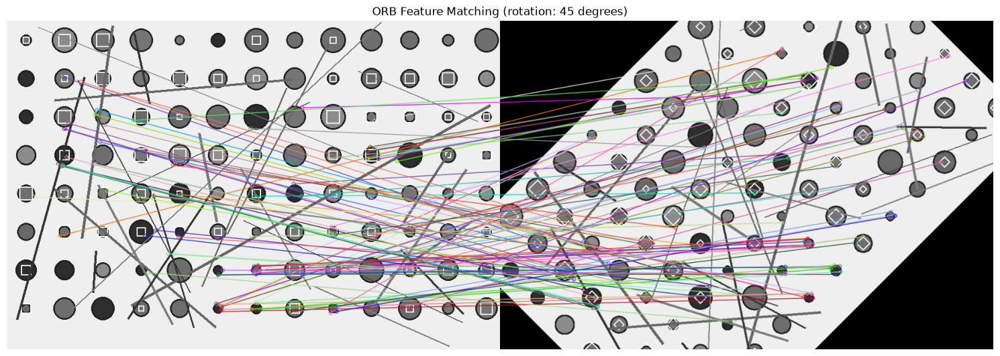

<div align="center">

# Computer Vision

**A collection of hands-on computer vision tasks built with Python and OpenCV.**

Explore image transformations, feature detection, and visual matching—one task at a time.

</div>

---

## Tasks

| # | Task | Description | Script |
|---|---|---|---|
| 01 | **ORB Feature Matching** | Detect ORB features in an image and a rotated copy, match their descriptors, and visualize the strongest correspondences. | [`tasks/task_01_orb_feature_matching.py`](tasks/task_01_orb_feature_matching.py) |

> Only Task 1 was present in the notebook provided for this repository. Add further exercises as separate scripts under `tasks/` and list them here.

## Quick start

### 1. Set up Python

Python 3.9 or newer is recommended.

```bash
python -m venv .venv
```

Activate the environment:

```powershell
# Windows PowerShell
.\.venv\Scripts\Activate.ps1
```

```bash
# macOS / Linux
source .venv/bin/activate
```

### 2. Install dependencies

```bash
python -m pip install -r requirements.txt
```

### 3. Run a task

Provide the path to an image on your computer. The script displays the plot and
saves a PNG to `outputs/task-01-matches.png` by default:

```bash
python tasks/task_01_orb_feature_matching.py path/to/your/image.jpg
```

To customize the rotation and number of matches:

```bash
python tasks/task_01_orb_feature_matching.py path/to/your/image.jpg --angle 30 --max-matches 50
```

To choose a different output file:

```bash
python tasks/task_01_orb_feature_matching.py path/to/your/image.jpg --output results/task-01-matches.png
```

The output directory is created automatically when needed. The `outputs/`
directory is ignored by Git so your input-derived images are not uploaded
without your choice. Use a path such as `results/task-01-matches.png` when you
want to keep and publish a particular visualization.

## Task 01 · ORB feature matching

The script follows these steps:

1. Loads the input image in grayscale.
2. Rotates a copy around its center (45° by default).
3. Detects ORB keypoints and computes binary descriptors for both images.
4. Matches descriptors using a brute-force matcher with Hamming distance and cross-checking.
5. Sorts matches by distance and draws the best matches side by side.

If the image cannot be opened or ORB cannot find descriptors, the script prints an actionable error and exits instead of attempting an invalid match.

### Recorded notebook output

The supplied notebook's recorded run printed:

```text
Total matches found: 771
Number of good matches selected: 100
```

These counts are from the notebook output shared with this project and are
preserved in [`results/task-01-notebook-output.txt`](results/task-01-notebook-output.txt).
The referenced source image was not included, so its exact match image cannot
be reproduced from the repository alone. The generated-image demonstration
below shows what the script produces.

### Visual demonstration

This example uses a locally generated geometric test image, not the missing
notebook photo. The example input and the visualization produced by Task 1 are
included in [`examples/`](examples/) so the result is visible on GitHub.



Running the task on this demo image found **653 matches** and drew the best
**100**. The captured run output is in
[`examples/demo-run-output.txt`](examples/demo-run-output.txt). Reproduce it with:

```bash
python tasks/task_01_orb_feature_matching.py examples/demo-input.png --output examples/demo-output.png
```

### Options

| Option | Default | Purpose |
|---|---:|---|
| `image` | Required | Input image path |
| `--angle` | `45` | Rotation angle in degrees |
| `--max-matches` | `100` | Maximum number of best matches to draw |
| `--output` | `outputs/task-01-matches.png` | Destination for the saved visualization |

## Project layout

```text
.
├── data/
│   └── README.md
├── examples/
│   ├── demo-input.png
│   ├── demo-output.png
│   └── demo-run-output.txt
├── outputs/                         # Generated images (not tracked)
├── results/
│   └── task-01-notebook-output.txt
├── tasks/
│   └── task_01_orb_feature_matching.py
├── .gitignore
├── README.md
└── requirements.txt
```

## Input data

The original notebook referenced an image at a Google Colab-only path, but the image file was not included with the shared notebook. No sample image is bundled here. Use an image you have permission to use, either by passing its path to the script or placing it under `data/`. See [`data/README.md`](data/README.md) for details.

Image files and generated visualizations are ignored by Git to help prevent accidental uploads of personal or copyrighted material.

## Adding a task

Create a new, descriptive Python script in `tasks/`, document its purpose and required inputs, and add a row to the task table above. Keep each exercise independently runnable.
